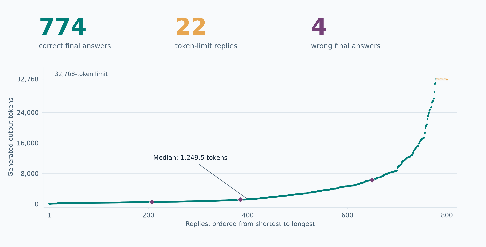
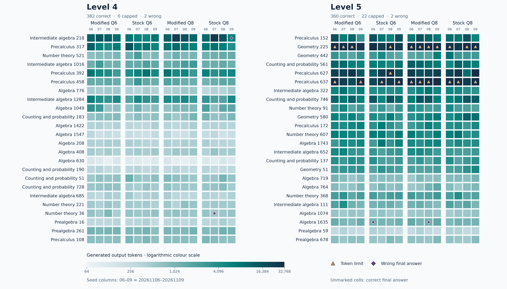
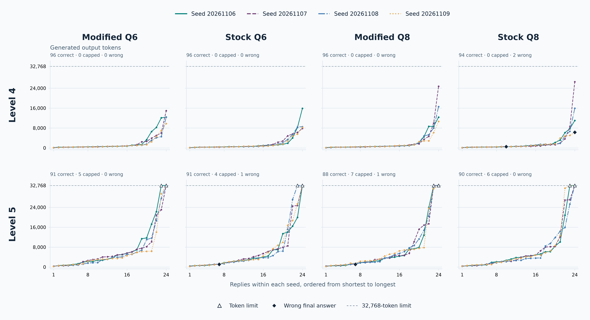
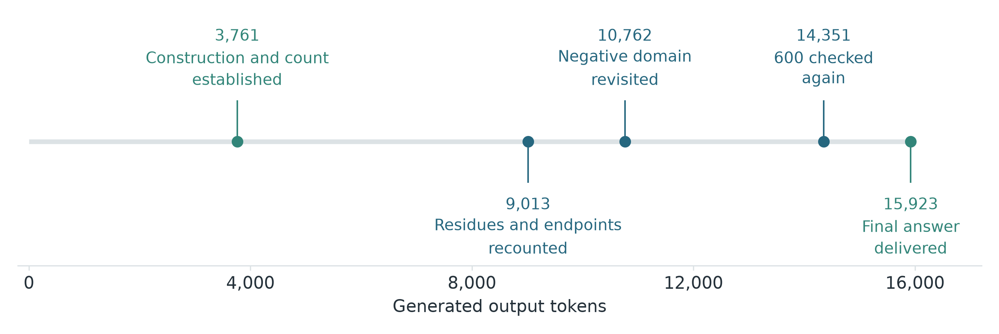
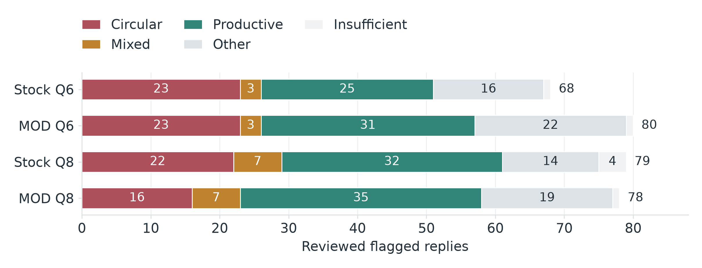
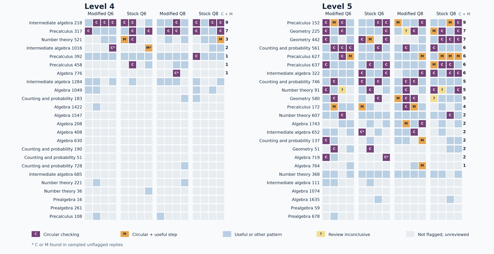
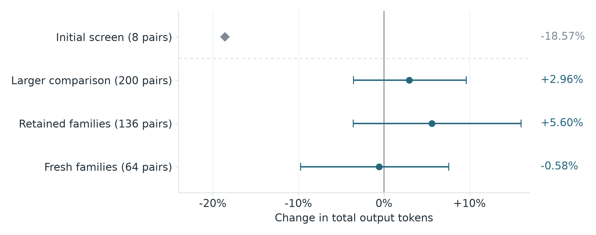
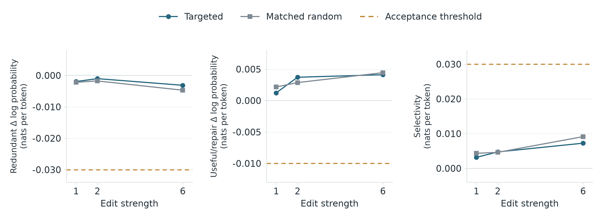

# Qwen3.8-27B: when checking becomes circulation

Over the last week the reposts of Astra changing the weights of the smaller model, improving its capability in maths has been all over my feed. [Original Link](https://rikiyat.github.io/blog/weight-space-programming/). 

In short, GPT-6 Astra checked the weights of Qwen3.5-0.8B, found the bug that was resulting in identical loops, removed it, and the model's performance on MATH-500 went from 7.9% to 48.1%. 

Quite a few reposts present this as frontier models now can read and write weights beyond what humans or algorithms can do. It is not entirely true, despite the fact that this study is actually quite cool. 

First of all, smaller models are the easier case for interpretability work, and 0.8B model runs on a normal office laptop, so in theory you can collect replies that loop and replies that don’t and compare their average activations layer by layer. The difference between these two gives the direction, and subtracting it from several MLP layers is a known process.

Regarding the issue with the reasoning loop, [Qwen’s model card](https://huggingface.co/Qwen/Qwen3.5-0.8B#thinking-mode) warns that the 0.8B model is prone to thinking loops (in fact, a few models are prone to this, but I'll get back to this later).

What is interesting, the fix that was applied here (finding one direction and subtracting it), is quite close to a direction ablation. Direction ablation is a well known technique that is used to strip refusals out of open-weight models. You can see the limits in the same original post, when Astra was instructed to make Gemma 3 270M better at maths, a model that rarely loops and mostly just makes ordinary mistakes in arithmetic, nothing improved.

What the result of this study made me think is something improved about training. My guess (only a guess), is that frontier labs now train on mechanistic interpretability environments, and probably on the open weight-space learning datasets too. 

[OpenAI mentioned](https://openai.com/index/research-acceleration-view-inside-openai/) that it is building an automated AI researcher. If similar tasks are part of how the frontier models are trained now, then finding and removing a loop direction in a small open model is something Astra has seen many times before. In this case doing it well is expected.  

That is still impressive, but not a new kind of ability that means doom for human-researchers.

Still, I was curious. What happens when there is no obstacle to remove, with a bigger model that is prone to overthinking?

## Measuring it first

I use Qwen3.8-27B quite a bit, mainly in four local quantised files. Stock Q6 and Q8, and the HauhauCS Aggressive uncensored versions, which I call MOD here.

It almost never gets stuck. But I kept noticing it goes back over parts it had already solved in its reasoning traces. Not looping in the 0.8B identical sense, literally overthinking is the best word I can find here. I also saw a few reports of the same behaviour here and there, but I could not find any sort of concrete data on this. 

I knew the transfer idea was a bit weak before I started, but pushing Astra onto a harder target than an identical loop was the point here.

But before removing a behaviour, I had to quantify what it looked like.

So I took a panel of 50 questions, mostly hard MATH problems (level 4 and 5), and ran each file four times with different seeds. That gave 800 replies.

Maths is relatively easy to work with at this level, because the answers are exact and the intermediate steps can be checked. 

And harder problems because that is when the reasoning tends to get longer and useful checking and "semantic loops" start to be more obvious.

The models got 774 of the 800 right.

 

Of the remaining 26, 22 ran out of token budget (so we have no knowledge if it would be correct or not) and just four finished with a wrong answer.

So the comparison, Qwen 3.5 0.8 B hit its token limit on 93% of answers in the original study, whereas Qwen 3.8 27b Q6 capped on under 3%. There was no obvious bug here to remove.

 

## Semantic circulation

I call the annoying behaviour semantic circulation, not sure if this is a proper term. Model returns to a resolved step, but continues, adding no new calculation, constraint, correction or checks. The words can change and the answer can still be right. It just loops in circles. 

One example: 

One question asked how many of the integers from 1 to 1,000 can be written as ⌊2x⌋ + ⌊4x⌋ + ⌊6x⌋ + ⌊8x⌋ for real x. The answer is 600, only six residues out of ten are possible.

In one stock Q8 run, the model had the six residues, the construction and the count by about token 3,800. 

Then it recounted the residues, went back to negative x, and was checking 600 again around token 14,350. 

It finished, correctly, after 15,923 tokens.

In another run the same model derived the same six residues and counted five. It answered 500 after 6,285 tokens. It checked its work in that run too. It went back over the interval analysis, which was right, and never recounted the set.

What bugs me is that in the first run the model spent more than 10,000 tokens re-checking an answer it already had right. 

Among the replies that were flagged by algorithm, the LLM review (Terra and Sol reviewers) found 104 cases of circulation or mixed circular and useful checking, and 93 of them still finished with a correct answer.

Additionally, not all hard reasoning is overthinking. In some problems, rethinking resolved ambiguities the model ran into. So whether a return is waste of resources depends on what it could change.

## The first edit looked like it might work

I designed the panel, the review and the evaluation.  After this was done,  Astra had access to the data and analysis and was instructed to propose and implement the weight edits.

Saved reasoning could be replayed through the same GGUF file and its internal activity recorded on the way.

Interestingly, the very first edit looked like it worked on initial tests. Astra compared internal activity in useful and redundant reasoning windows, found a direction, and changed 64 columns of the MLP in layer 51. That was our V1. On its first run, eight problems, it saved 18.6% of tokens with the same accuracy. Those eight problems had been inspected during development, the confirmation stage was following after.

Unfortunately, a 50-question paired test across all seeds showed no reliable benefit. V1 used about 3% more tokens and got 192 right  (the original run got 195), and two more replies hit the token cap. These differences were compatible with sampling variation, but the previous18.6% saving did not hold.

 

## Every theory Astra had

I instructed Astra to work more on the problem and what came next was more interesting, because each attempt was a new theory of where circulation may live in the model. 

Theory one. There is a “go back and check” direction in an MLP layer. Astra tested a direction like this. It separated redundant from useful tokens with an AUROC of 0.94 on the data it was fitted on, but only 0.83 on problems it hadn’t seen. Token position alone, meaning just how far into the reply a token sits, scored 0.845. Redundant rechecks usually come late in a reply and useful work comes early, so the direction did no better than token position alone.

Theory two. If the V1 edit was hitting useful reasoning too, build an edit that pushes against the redundant pattern while being penalised for changing anything the model does during useful work. Astra did this at layer 50, on 256 selected features. With a floating-point adapter it finished all four development problems. Once exported into a normal quantised file, it ran out of tokens on one of them. In one candidate the final answer was correct, however the maths in the explanation wasn't.

Theory three. The model keeps checking because it’s unsure, so the idea was to make it more confident. Astra multiplied the final normalisation weights by 1.1. These weights go directly into the output layer, so every logit gets multiplied by 1.1, which is similar to sampling at a temperature of around 0.9 instead of 1.0. The final answers stayed correct again (despite an error in reasoning in one question) replies got longer, not shorter. Which is not a big surprise in this case, as reasoning models, including DeepSeek-R1-distilled models, are known to [“loop” more at lower temperatures](https://proceedings.mlr.press/v306/pipis26a.html).

Theory four. The edit might work better if it was fitted to states right before a reviewed return begins. It solved 6 of the 8 questions (the original solved all 8) and two long problems that used to finish before now ran out of tokens.

I suspect that both moments, before a pointless recheck and a useful one, may look quite similar, so pushing this edit disturbed work the model needed.

And control. Taking directions only from states before a return begins, edit 64 columns in each of two layers, try three strengths, and fix the pass and fail rules before seeing any result. Astra also added one fixed random control of the same size. At the strongest setting the targeted edit was slightly less selective than the random one, 0.0073 against 0.0091 nats per token. Both effects were tiny. None of the strengths passed the rules we set in advance.

There can be many more similar probes done, but we stopped there.

## Why is it hard even for such a powerful model like Astra?

Redundancy of the reasoning is not that easy to define, and if the criteria are vague, the process will learn the reviewers choices, which might not reflect the next set of problems, let alone a different topic. 

Every theory was reasonable, but my guess is that in the big models (and 27b is relatively big in this case), the redundancy isn’t in one place in the network. Recounting the residues is wasted work once the count is settled, but it may be the right move when the count is the thing in doubt. Whether a check is useful depends on which claim in the reasoning is still uncertain at that moment, and that changes as the reasoning goes on. A fixed edit applies the same rule at every token. The edits we tried did not reliably tell those two situations apart.

The 0.8B model was what in plain words can be called "stuck", so removing one bug helped. Qwen 3.8 27 B is doing well most of the time, but IS sometimes inefficient. And that needs a much more delicate edit, and more likely post-training and RL. So I have no hard feelings towards these failures. 

So what did I get out of this? Mainly a better picture of the behaviour itself. 

Only about a third of the replies the text-similarity screen flagged were actually circular, so repetition alone is a poor way to find this behaviour.

Most of the circular ones still ended with the right answer, and the cost sat in a long tail, with the average reply more than three times the length of the typical one. I also tested for memorisation. Qwen could rarely reproduce the rest of the questions from a partial prompt and kept rechecking finished work on more fresh problems as well.

So while this study is small, it looks like it may be a general habit in how the model checks its work, and not something these direction edits reliably removed. My guess is that such behaviour is set in post-training, when checking gets rewarded more often than knowing when to stop.

If that’s correct, the fix is more likely to come from training. Unsurprisingly, the model’s problem is the current research problem. ([Chen et al.](https://proceedings.mlr.press/v267/chen25bx.html), [Peng et al.](https://arxiv.org/abs/2505.23480))