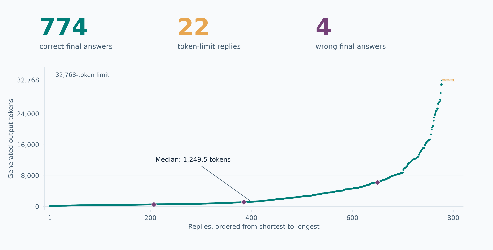
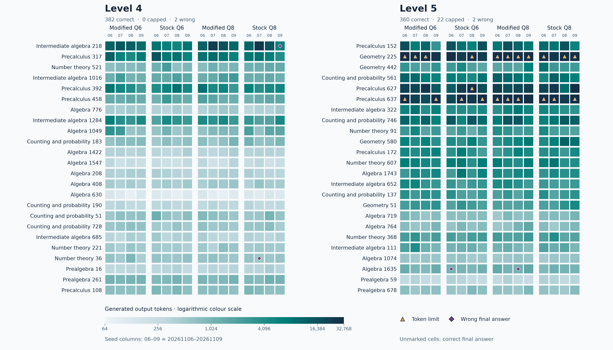
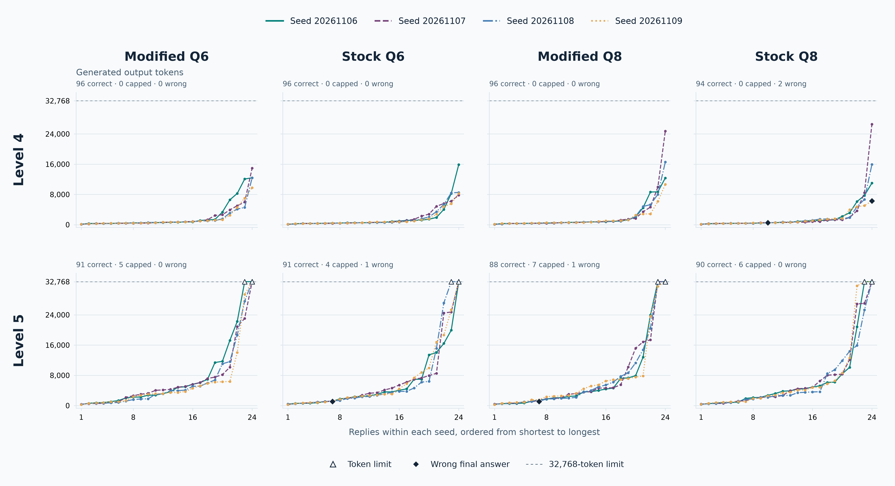
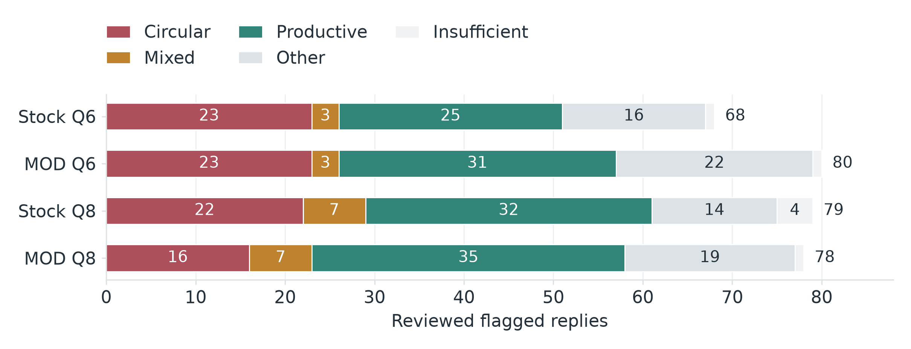
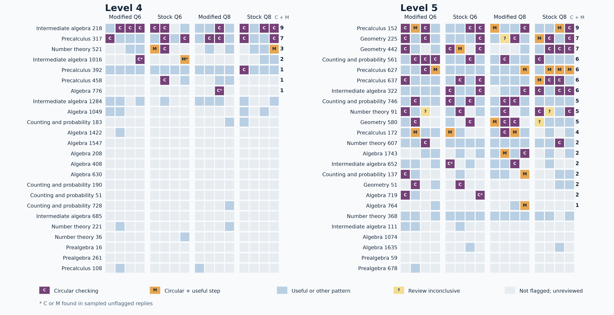
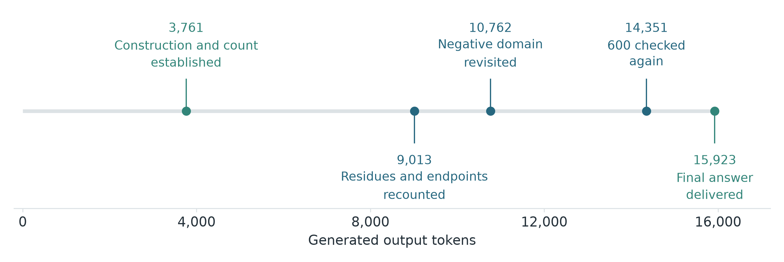
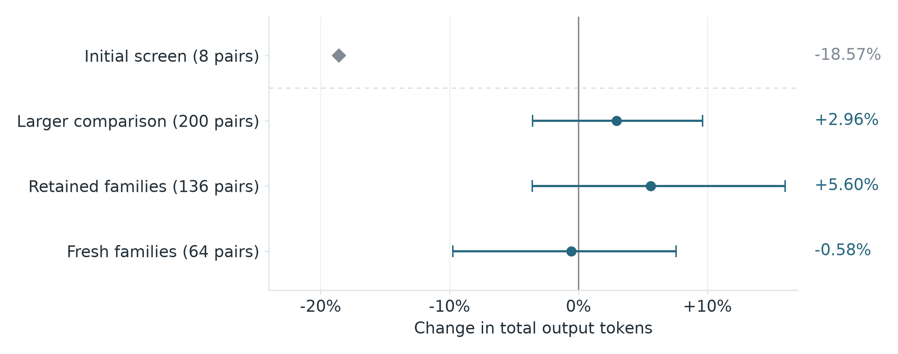
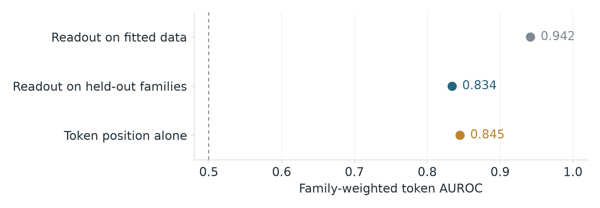
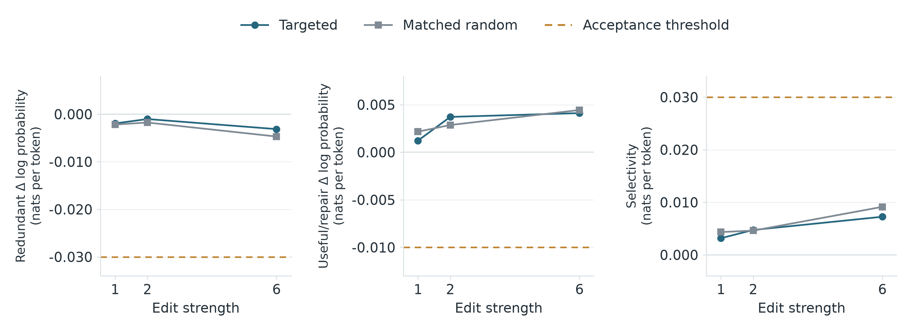

# Qwen3.8-27B: redundant checking and fixed weight edits

[Blog post](README.md) · [Supporting data](data/README.md)

Semantic circulation in Qwen3.8-27B was measured. This work tested whether fixed weight edits could reduce it. Circulation was defined as a return to an established result without a new calculation, constraint, correction or useful check. The objective was to reduce redundant reasoning while preserving useful work and final-answer accuracy.

The panel, review and evaluation were designed by the author. Hypotheses and weight edits were proposed and implemented by GPT-6 Astra.

## Setup

Four quantised files of the model were evaluated: stock Q6 and Q8, and the HauhauCS Aggressive variants, designated MOD Q6 and MOD Q8. The stock files were Unsloth UD-Q6_K_XL and UD-Q8_K_XL. The MOD files were Q6_K_P and Q8_K_P. A shared panel of 50 questions was used: 24 MATH Level 4 questions, 24 Level 5 questions, one GSM8K question and one finite-state shortest-path problem. Each file was sampled with four seeds, giving 800 replies. Thinking was enabled. Temperature was set to 1.0, top-p to 0.95 and top-k to 20, with no repetition penalties. The output limit was 32,768 tokens and the context limit was 40,960 tokens. [Evaluation settings](data/01_selection.json)

| File | Correct answers | Replies at token limit | Completed wrong answers |
|---|---:|---:|---:|
| Stock Q6 | 195/200 | 4 | 1 |
| MOD Q6 | 195/200 | 5 | 0 |
| Stock Q8 | 192/200 | 6 | 2 |
| MOD Q8 | 192/200 | 7 | 1 |
| Total | 774/800 | 22 | 4 |

Final answers were compared with reference answers, allowing equivalent answer formatting. Across all replies, the mean output length was 4,322 tokens and the median was 1,250. Most answers were correct, but output length had a substantial upper tail. [Answer counts](data/02_primary_panel_counts.json)

*All 800 replies, ordered by output length. Counts include reasoning and final answers.*

*The 768 MATH replies comprise 742 correct answers, 22 capped replies and four wrong answers. The two control questions contribute 32 additional correct replies. Colour is logarithmic. Triangles mark token limits and diamonds wrong answers. [Cell data](data/reply_length_heatmap.csv).*

*Each curve ranks 24 replies within one seed. Equal ranks can represent different questions. All panels use the same linear token scale. Triangles mark token limits and diamonds wrong answers. [Group statistics](data/reply_length_by_model_level_seed.csv).*

## Behaviour

A text-similarity screen was used to select replies for semantic review by Terra and Sol. Of 305 flagged replies, 84 were classified as circular and 20 as containing both circular and useful checking. Of these 104 replies, 93 ended correctly, ten reached the token limit and one ended incorrectly. Thus, circular or mixed checking was identified in 34.1% of the flagged replies. This proportion describes the screened set. It is not an estimate of prevalence among all replies. [Review results](data/03_results.json)

*Of 305 flagged replies, 84 were circular and 20 mixed circular and useful checking. [Chart data](data/semantic_review.csv).*

*The 768 MATH replies include 103 reviewed circular or mixed cases: 24 at Level 4 and 79 at Level 5. Asterisks mark five cases found in sampled unflagged replies. Grey cells were unreviewed. Six circular replies from the finite-state control are outside this grid. Columns within each file are seeds 20261106–20261109. [Cell data](data/circularity_heatmap.csv).*

Each flagged reply was first labelled in three independent reviews by [Terra/Sol]. The 182 replies with disagreement, low confidence or insufficient evidence received a second review by [Terra/Sol] with wider context, and its label was final. A first-round majority supported circular or mixed checking in 42 of the 104 flagged cases, and the other 62 were assigned at second review. First-round agreement was κ = 0.47 across the five categories and 0.68 for circular or mixed against all other labels.

The distinction was illustrated by a floor-function problem whose answer was 600. In one stock Q8 reply, the six admissible residues, their construction and the count had been established by approximately token 3,800. The residues and negative-input cases were subsequently revisited, and 600 was checked again near token 14,350. The correct answer was delivered after 15,923 tokens. In another reply, the same six residues were listed but counted as five, producing 500 after 6,285 tokens despite further checking. [Correct reply](data/04_d12615ce63216ad87776003940749dba13a4c152bdd2b50b78dc65632cfb18dc.json), [incorrect reply](data/05_da4a9b886bf2686a6cac76addf0df03ae4790b5c4667308e9e7d132140a956b8.json)

*A complete construction and count preceded final delivery by more than 12,000 tokens.*

In a separate partial-prompt test, the original question suffix was reconstructed exactly in one of 48 cases. Redundant checking was also observed on recent problems. These observations do not exclude memorisation or contamination. [Follow-up results](data/15_study_results.json)

## Edits

Weight edits were constructed with GPT-6 Astra using saved reasoning traces and replayed activations. MOD Q6 was used as the base model. Layer numbers below follow the zero-based tensor indices.

For V1, a direction was derived from contrasts between useful and redundant reasoning activations. A rank-one correction was applied to 64 columns of the MLP down-projection in layer 51. The eight initial problems had been inspected during development, so this screen was not an independent confirmation. With an 8,192-token limit, total output was reduced from 41,211 to 33,559 tokens, a saving of 18.6%. Seven answers were correct and one reply reached the limit in each condition. [Initial results](data/06_result_summary.json)

V1 was then evaluated against its unedited base on 50 paired questions across four seeds, with a 32,768-token limit. The panel contained 34 retained questions and 16 new questions.

| Condition | Correct answers | Replies at token limit | Total output tokens |
|---|---:|---:|---:|
| Unedited MOD Q6 | 195/200 | 5 | 976,471 |
| V1 | 192/200 | 7 | 1,005,385 |

Output increased by 3.0%. The 95% interval from resampling questions was −3.6% to +9.6%. A reliable token saving was not established. [Paired results](data/07_scores.json), [uncertainty estimates](data/08_summary.json)

*Token changes relative to the unedited base. Error bars are 95% intervals from resampling questions. The initial development screen has no interval.*

The direction hypothesis was also assessed with a layer-50 activation probe. An AUROC of 0.942 was obtained on the fitted data, falling to 0.834 when problem families were held out. Absolute token position alone gave an AUROC of 0.845. Separation beyond that provided by position alone was therefore not demonstrated. [Projection results](data/09_position_confound.json)

*Held-out probe discrimination did not exceed the position-only result.*

A preservation-constrained edit was fitted at layer 50 using 256 selected features. Changes during useful reasoning were penalised. With a floating-point adapter applied to the quantised base, all four development problems were answered correctly. After the correction was merged into a quantised GGUF file, three were answered correctly and one reached the 8,192-token limit. One candidate from this approach also produced a correct final answer with an incorrect algebraic explanation. [Adapter results](data/10_summary.json), [GGUF results](data/11_summary.json)

Output sharpening was tested by multiplying the final normalisation weights by 1.1. This scales the logits, approximately corresponding to a temperature change from 1.0 to 0.909. On five development problems, all final answers remained correct, but output increased from 7,466 to 8,576 tokens, or 14.9%. An incorrect base conversion was present in one final explanation. [Output-gain results](data/12_results.json)

An edit was also fitted from states preceding reviewed returns. [Layer 23 and 128 features](data/pre_return_fit.json) were selected. On eight problems excluded from calibration, six answers were correct, compared with eight for the unedited model. Two previously completed replies reached the token limit. [Pre-return results](data/13_results.json)

## Controlled test

Finally, directions were fitted from the 16 tokens preceding reviewed returns and useful checks. Corrections were applied to 64 columns in each of layers 26 and 30 at strengths 1, 2 and 6. One fixed random control was used: one orthogonal direction per layer, with matched correction norms, reused across all three strengths. Continuation likelihood was measured at 26 locations across six selection families. Selectivity was defined as the change in mean log probability of useful checking and repairs minus the corresponding change for redundant returns, averaged equally across problem families. The criteria were fixed before scoring and required redundant suppression of at least 0.03 nats per token, selectivity of at least 0.03, and an advantage of at least 0.02 over the random control, alongside useful-work preservation and consistency across families. [Control design](data/control_design.json).

At the strongest setting, selectivity was 0.0073 nats per token for the targeted edit and 0.0091 for the random control. At strength 6, suppression was only 0.0031 for the targeted edit and 0.0047 for the control. No selective benefit was established within the tested strength range. All three strengths failed the criteria. Transfer evaluation and free generation were therefore not performed.

The correction was verified to be applied as intended (relative error 7.4 × 10⁻⁷, with baseline logits restored exactly on removal), and at strength 6 it changed the edited weight matrices by about 3.0% and 3.6%. This establishes a working intervention but not sufficient influence on redundant checking.

[Control results](data/14_gate.json)

*Dashed lines show the suppression, useful-work preservation and selectivity thresholds. The additional required advantage over random was 0.02 nats per token.*

## Conclusion

Redundant checking was observed in replies that usually ended correctly. A reproducible reduction in this behaviour with preserved answer quality was not established by the tested edits. Neither its location in the network nor its origin in training was established.
